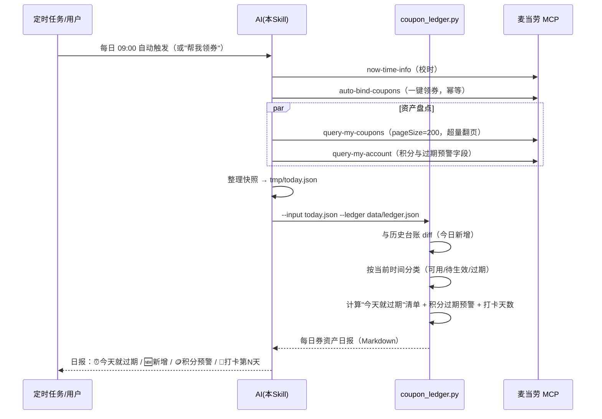

# MCP 集成说明 · 麦麦每日领券管家

本文档说明本项目实际使用的麦当劳 MCP Server、Tool 清单、调用流程与业务价值。

- **MCP Server**：麦当劳 MCP（Streamable HTTP），接入地址 `https://mcp.mcd.cn`
- **鉴权**：请求头 `Authorization: Bearer <MCD_MCP_TOKEN>`（Token 由[开放平台](https://open.mcd.cn/mcp)申请，仓库内仅以环境变量占位符出现）
- **官方文档**：[M-China/mcd-mcp-server](https://github.com/M-China/mcd-mcp-server)

## 一、使用的 Tool 清单与业务价值

| 环节 | Tool | 用途 | 业务价值 |
|---|---|---|---|
| 校时 | `now-time-info` | 获取服务器时间，作为日报日期与券状态判断基准 | 券的有效期精确到时段（如早餐券 05:00-10:29），时间基准必须取服务端 |
| **领券（核心）** | `auto-bind-coupons` | 一键领取麦麦省全部当前可领券，无需指定 couponId | **每日自动领券的能力来源**；幂等设计（已领满返回"暂无可领取"），适合定时高频执行 |
| 领券（辅助） | `available-coupons` | 查询当前可领的麦麦省券列表与领取状态 | 日报中区分"今天新领了哪些"与"一直没领到哪些" |
| 盘点 | `query-my-coupons` | 拉取卡包全部券（名称、用券价、有效期、渠道标签） | 台账引擎的数据源；识别"今天就过期"的券 |
| 盘点 | `query-my-account` | 积分余额 + 本月/下月将过期积分 | **积分静默过期的唯一预警手段**（实测字段：`currentMouthExpirePoint` / `nextMouthExpirePoint`） |
| 盘点（可选） | `query-nearby-stores` + `query-meals` | 取最近门店菜单，按券名匹配餐品原价 | 为折扣率计算提供 `originalPrice`；失败不阻塞（买一送一类券引擎自动按 5 折估算） |
| 加值 | `campaign-calendar` | 当月营销活动日历 | 用户问"最近有什么活动"时一站式回答 |
| 加值（只读） | `query-lottery-info` | 查询积分抽奖活动信息（奖品、消耗规则、剩余次数） | **只读监控**，绝无自动抽奖 |
| 加值（按需） | `query-store-coupons` | 查询指定门店+订单类型下的可用券 | 用户问"这张券在哪家店能用"时使用（需先取门店） |
| 加值（按需） | `query-my-prizes` | 查询抽奖中奖记录与核销状态 | 奖品也是资产，纳入盘点视野 |

## 二、核心调用时序（每日定时执行）

## 三、来自真实数据的两个产品洞察（本项目立论依据）

1. **券按天投放，不天天管就漏**：实测 2026-10-13 卡包中有 8 张早餐券，分别只在 10-14 至 10-21 各自当天 05:00-10:29 有效。用户即便领了券，若没人每天提醒，"当天早餐券"极易错过 → 日报必须把"今天就过期"置顶。
2. **积分静默过期**：实测账号累计积分 217.5，可用仅剩 88.9，`expiredPoint=128.6`——历史已过期近六成，且从未有提醒 → `currentMouthExpirePoint` 是必须每天盯的字段。

## 四、关键设计决策

1. **领券用 `auto-bind-coupons` 而非逐张领取**：官方工具天然幂等（"暂无可领取的优惠券"即已领满），定时任务天天跑也不会产生副作用，也无需维护 couponId 清单。
2. **台账在本地，状态在云端**：diff（新增/打卡/连续天数）由本地 `coupon_ledger.py` 完成，券的最终状态一律以 `query-my-coupons` 实时返回为准，杜绝误判。
3. **合规边界前置**：本 Skill 明确**不调用** `create-order` / `cancel-order`；`draw-lottery` 因官方要求"必须先展示消耗规则并获用户明确确认"，默认路径中也只做 `query-lottery-info` 只读监控——"管家只管资产，花钱必须本人点头"。
4. **快照幂等入账**：同一天重复执行只覆盖当日快照，不产生重复打卡记录，定时任务重试安全；报告生成在台账更新**之前**进行，保证"今日新增"以昨日台账为基准。
5. **价格语义诚实**：MCP 返回的券面金额是"用券价格"（持券支付价），不是"省下金额"；日报与文案统一表述为"用券价 ¥X"，避免夸大优惠。
6. **折扣率计算的两级降级**：有原价 → 精算（买一送一按"÷单件原价×2"）；无原价但券名含"买一送一" → 按 5 折估算并标注"≈"；其余无原价券 → 不展示折扣，**绝不编造原价**。

## 五、限流与容错

- 单 Token 限流 600 次/分钟：单次运行最多 5-6 次调用，余量充足；重复运行时台账本地 diff，不重复拉取。
- 429：指数退避重试（1s → 2s → 4s），仍失败则告知用户稍后再试。
- 401：提示用户检查 Token 配置，不输出任何凭证内容。
- MCP 返回空券包：日报照常生成（"今日无可用券"），保持打卡连续性。
