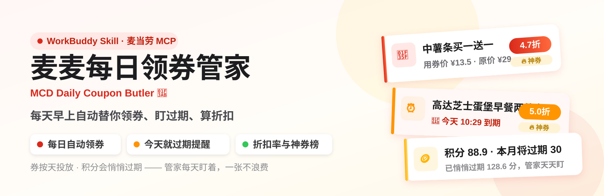

<div align="center">
  
</div>

# 🎫 麦麦每日领券管家 · MCD Daily Coupon Butler

> 🌟 **正在参加「麦当劳程序员节创意开发大赛」，榜单按 ⭐ Star 数排名**
> 如果它帮你捡回过一张快过期的券，请点一下右上角的 **Star** —— 每个 Star 都是管家明早继续替你领券的动力！🍟✨

> ☀️ 每天早上自动完成：**一键领券 → 券包盘点 → 临期预警 → 积分过期提醒 → 一张日报**
> 你要做的只剩一件事：今天这张 9.9 的早餐券，记得在 10:29 前用掉。

基于[麦当劳 MCP](https://github.com/M-China/mcd-mcp-server) 能力开发的优惠券资产管家 Skill。配一条定时任务，它就是你麦门资产的"每日自动值班员"。

## 🤔 为什么是它

先看两个真实数据（来自作者账号 2026-10-13 的实测）：

1. **麦当劳的券是按天投放的**——卡包里躺着 10-14、10-15、10-16……每天一张的早餐券，每张**只在当天 05:00-10:29 有效**，不天天盯着领、盯着用，就白白错过。
2. **积分会静默过期**——`query-my-account` 返回：累计积分 217.5，可用只剩 88.9，**已过期 128.6**。没有任何人提醒过。

| 😩 痛点 | 🙈 传统做法 | 🦹 麦麦每日领券管家 |
|---|---|---|
| 新券要自己记得领 | 想起来才翻小程序 | ☀️ 每天定时 `auto-bind-coupons` 一键领满 |
| 券领了就忘，转头过期 | 券包一翻全是"已过期" | ⏰ 日报置顶"今天就过期"清单，一张不浪费 |
| 积分悄悄清零 | 过期了才发现 | 🪙 本月/下月将过期积分显著预警 |
| 不知道自己有多少券 | 从不盘点 | 📊 台账引擎日日盘点 + 连续打卡统计 |

## ✨ 功能特性

- ☀️ **每日自动领券**：`auto-bind-coupons` 自动领取麦麦省全部可领券，"暂无可领取"= 已领满（幂等，天天跑也无压力）
- 📒 **券资产台账引擎**（`scripts/coupon_ledger.py`，纯标准库零依赖）
  - 与历史台账 diff，自动识别"今日新入手"
  - 按当前时间分类：可用中 / 已领待生效 / 已过期
  - **"今天就过期"置顶预警** + N 天内临期清单（`--warn-days` 可调）
  - 积分过期预警（本月/下月将过期积分）
  - 连续打卡天数统计，领券也有正反馈
- 🏷️ **折扣率与实惠度评级**：每张券自动算折扣——买一送一按"÷（单件原价×2）"精算、无原价按 5 折估算，输出 **≤5折 神券🔥 / ≤7折 超值✨ / ≤8.5折 划算👍 / 常规** 四档评级 + 预计省多少，"今天最值得用的神券"直接写进建议
- 🖼️ **官方券图直出**：`query-my-coupons` 返回的券图 URL 直接渲染进日报卡片，一眼认出是哪张券；无图自动降级为文字卡
- 📄 **HTML 每日日报**：Apple 风格卡片版式——顶部 🚨 告警横幅（今天过期/积分清零）+ 四宫格核心数据磁贴 + 双栏券卡（少滚动，一屏看完）+ 待生效折叠区，`--report` 传 `.html` 或 `.md` 即切换格式
- 🔍 **加值查询**：当月活动日历、积分抽奖**只读监控**、门店可用券查询
- 🛡️ **合规边界清晰**：只领券、不下单、不自动抽奖——`draw-lottery` 有官方强确认要求，本 Skill 默认只读监控，绝不越界

## 🚀 快速开始

### 1️⃣ 申请 MCP Token
前往[麦当劳 MCP 开放平台](https://open.mcd.cn/mcp)，手机号登录后在控制台激活 Token。🔑

### 2️⃣ 配置 MCP Client
以 WorkBuddy 为例（Cursor / Cherry Studio / Trae 同理）：在自定义连接器中添加 MCP，填入 `mcp-config.example.json` 的内容，并将 `${MCD_MCP_TOKEN}` 替换为你的真实 Token（**真实配置文件请勿提交到仓库**）。

```json
{
  "mcpServers": {
    "mcd-mcp": {
      "type": "streamablehttp",
      "url": "https://mcp.mcd.cn",
      "headers": { "Authorization": "Bearer YOUR_MCP_TOKEN" }
    }
  }
}
```

### 3️⃣ 安装 Skill（三选一）

**🗣️ 方式一：一句话安装（WorkBuddy 用户推荐）**
```
帮我安装这个 Skill：https://github.com/qufuhcj/mcd-daily-coupon-butler
```

**⌨️ 方式二：一行命令安装**
```bash
git clone https://github.com/qufuhcj/mcd-daily-coupon-butler.git ~/.workbuddy/skills/mcd-daily-coupon-butler
```

**🧩 方式三：其他 MCP Client**
将 `SKILL.md` 作为系统提示词/规则文件加载即可。

### 4️⃣ 配上"每天自动"（WorkBuddy 用户）
安装后对 WorkBuddy 说一句：
```
每天早上 9 点帮我执行麦麦领券管家流程，生成每日券资产日报
```
WorkBuddy 会创建定时任务：自动领券 → 盘点 → 生成日报。**从此领券这件事，从你的待办里消失了。**

### 5️⃣ 或手动触发
直接说人话：
```
帮我领一下今天的券 / 券快过期了吗 / 我的积分要过期了吗
```

## ⚙️ 台账引擎独立使用

引擎可脱离 AI 单独跑（方便调试与复现）。`--report` 传 `.html` 生成卡片版式日报，传 `.md` 生成纯文本版：

```bash
# 用示例数据跑第一天的 HTML 日报
python3 scripts/coupon_ledger.py --input examples/sample_today.json \
    --ledger data/ledger.json --report reports/2026-10-13.html --warn-days 1

# Markdown 版 / 机器可读摘要
python3 scripts/coupon_ledger.py --input examples/sample_today.json --report reports/2026-10-13.md
python3 scripts/coupon_ledger.py --input examples/sample_today.json --json
```

📊 实测输出节选（真实数据，2026-10-14，Markdown 版；HTML 版见 `reports/` 同款版式）：

```
# 🎫 麦麦每日券资产日报 · 2026-10-14
> 打卡第 2 天 ｜ 券包共 10 张（可用 2 · 待生效 8） ｜ 今日新增 1 张

## ⏰ 今天就过期（抓紧用）
- **高达芝士蛋堡早餐两件套** 用券价 ¥9.9 ≈5.0折·神券（约省¥9.9） **今天到期**（2026-10-14 10:29） ［到店专用］

## 📆 已领待生效
- **板烧鸡腿堡买一送一** 用券价 ¥22 4.5折·神券（约省¥27） 2026-10-20 23:59（剩 6 天） ［到店专用］

## 🪙 积分账户
- 可用积分：68.9
- ⚠️ 本月将有 30 积分过期，尽快到麦享会使用或兑换
```

## 📁 项目结构

```
mcd-daily-coupon-butler/
├── SKILL.md                  # 🧠 Skill 编排指令（AI 的工作流大脑）
├── scripts/
│   └── coupon_ledger.py      # 📒 券资产台账引擎（diff/临期/折扣评级/打卡，纯标准库）
├── examples/
│   └── sample_today.json     # 📋 实测快照样例（含原价，可直接复现日报）
├── MCP_INTEGRATION.md        # 🔗 麦当劳 MCP 集成说明（调用链与时序图）
├── mcp-config.example.json   # 🔑 MCP 配置模板（环境变量占位符）
├── CONTEST_DECLARATION.md    # 📜 参赛声明（官方原文）
└── README.md
```

## 👥 目标用户

- 🥣 每天/每周都吃麦当劳，但从不翻券包的打工人
- 💸 对"券过期了才知道有"深恶痛绝的省钱党
- 🤖 想体验"AI 每天自动替我打理资产"的开发者

## 🙏 支持一下

你的早餐券今天又双叒过期了？→ **右上角 ⭐ Star 一下**，让管家明早准时叫你用券！🍟

## 📜 声明

本项目为麦当劳程序员创意开发大赛参赛作品，由作者独立开发，非麦当劳官方产品。券信息、积分数据及活动状态以麦当劳官方渠道实时结果为准；本 Skill 只做资产盘点与提醒，不代客下单、不自动抽奖。使用麦当劳 MCP 服务须遵守其[服务规则](https://cdn.mcd.cn/cms/pages/MCPServerRules.html)。
